 

**Final-year Software Engineering & Business/Technology student in Madrid.** 
Designing, building and improving reliable software systems, with a focus on AI, data, blockchain, cloud and FinTech.

 

 

## What I focus on

<table width="100%">
<tr>
<td width="33%" valign="top">

**Backend & Cloud** 
Reliable services, containers and deployment workflows on AWS.

</td>
<td width="33%" valign="top">

**AI & Data** 
Data pipelines, graph analysis and multi-agent systems.

</td>
<td width="33%" valign="top">

**Blockchain & FinTech** 
On-chain governance and large-scale DAO research across 85K+ DAOs.

</td>
</tr>
</table>

## Tech stack

<table width="100%">
<tr>
<td width="160"><b>Languages</b></td>
<td></td>
</tr>
<tr>
<td><b>Web</b></td>
<td></td>
</tr>
<tr>
<td><b>Cloud & tools</b></td>
<td></td>
</tr>
<tr>
<td><b>Blockchain</b></td>
<td> <code>Ethereum</code> · <code>Web3</code> · <code>ERC-20</code></td>
</tr>
<tr>
<td><b>Data & AI</b></td>
<td><code>Pandas</code> · <code>NetworkX</code> · <code>Jupyter</code> · <code>SQL</code> · <code>REST APIs</code> · <code>AI Agents</code></td>
</tr>
<tr>
<td><b>Algorithms</b></td>
<td><code>Graphs</code> · <code>Dynamic Programming</code> · <code>Greedy</code> · <code>Priority Queues</code></td>
</tr>
</table>

 

*Always learning, building and looking for the next challenge.*

